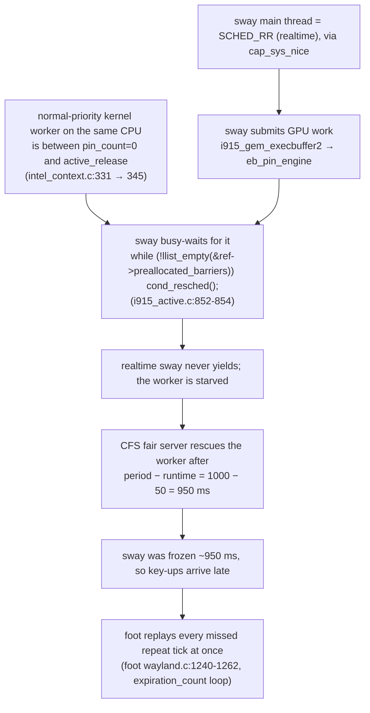

# stutter_fix

Fix for random multi-key presses ("cassssssssssse", "orrrrrrrrrr") on sway, on both the
built-in keyboard and a Bluetooth keyboard.

Machine: ThinkPad T480 (Intel UHD 620 + GeForce MX150), CachyOS kernel 7.2.7, sway 1.12,
wlroots 0.19, foot 1.28.

## Fix

```sh
./install.sh             # re-runs itself with sudo
./install.sh uninstall   # undo
```

It does five things:

1. `setcap -r /usr/bin/sway`: removes the capability that lets sway make its main thread realtime.
2. Installs `sway-no-realtime.hook` into `/etc/pacman.d/hooks/`. The sway package runs
   `setcap cap_sys_nice+ep usr/bin/sway` in `post_upgrade`; the hook removes it again
   after every sway install or upgrade.
3. Installs `sway-wrapper.sh` as `/usr/local/bin/sway` (ahead of `/usr/bin` in `PATH`). It runs
   `prlimit --rtprio=0: /usr/bin/sway`, which closes the second way sway can become realtime
   (see below). Only the soft limit is lowered; the hard limit stays at 99, so programs started
   from sway can raise it again.
4. Installs `sway-sched-guard.sh` as `/usr/local/bin/sway-sched-guard` and
   `90-no-realtime.conf` into `/etc/sway/config.d/` (the user config includes that directory).
   sway runs the guard at startup and it switches that sway back to `SCHED_OTHER`. This covers
   launches that skip the wrapper (`/usr/bin/sway` directly, a display manager whose `PATH`
   lacks `/usr/local/bin`) and a capability that comes back anyway. Tested: a headless
   `/usr/bin/sway` stays `SCHED_RR` without the guard and is `SCHED_OTHER` within 0.3 s with it.
5. `chrt --other --all-tasks --pid 0 <sway>`: switches the running sway to normal scheduling,
   so no logout is needed.

sway keeps its nice −12 from ananicy-cpp; only realtime scheduling is removed.

### Why steps 1–2 alone were not enough

sway calls `pthread_setschedparam(SCHED_RR, 1)` at startup (`sway/realtime.c`). That call
succeeds with `cap_sys_nice` **or** with a non-zero `RLIMIT_RTPRIO`. `cachyos-settings`
1.4.1 (installed 2026-09-26) ships `/etc/security/limits.d/20-audio.conf`
(`@audio - rtprio 99`), and this user is in `audio`. The capability was removed on
2026-10-10 and the running sway was switched with `chrt`, so everything looked fixed. The next
sway start (after a reboot) became `SCHED_RR` again through the rlimit, with `getcap` still
empty. Steps 3 and 4 block this path.

## Cause



- **Wayland key repeat is done by the app**, not by the keyboard or sway. If a key-up reaches
  the app more than `repeat_delay` (600 ms) after the key-down, the app treats the key as held.
  foot then sends all the missed 40 ms repeats in one burst: 600 ms + 9 × 40 ms ≈ 1 s, so 10
  copies of the letter. This is why both keyboards were affected.
- **`cond_resched()` is a no-op under `PREEMPT(full)`.** Under realtime scheduling, nothing
  normal-priority on that CPU can run until the kernel's fair server steps in. The fair server
  only steps in after 950 ms of realtime CPU use, which is why every freeze was 947–955 ms long.
- **The i915 busy-wait is still in mainline**, and no upstream patch was found. Updating the
  kernel, BIOS or firmware would not have fixed it. With sway at normal priority, the waiting
  worker gets the CPU right away, so the wait ends almost immediately.

## Evidence

| Measurement | Before fix | After fix |
|---|---|---|
| sway freezes > 120 ms | 3–9 per ~3 min, each 945–955 ms | 0 in 180 s |
| sway IPC round-trip, max | ~950 ms | 14 ms |
| sway kernel CPU time | 14.2 s per 170 s | 5.0 s per 180 s |
| CPU time inside one freeze | ~940 ms kernel, ~0 ms user, 0 page faults | n/a |

The kernel stack during a freeze was captured with SysRq-L, identically in 3 of 3 freezes:

```
RIP: 0010:i915_active_acquire_preallocate_barrier+0x40/0x3c0 [i915]
 __intel_context_do_pin_ww
 eb_pin_engine
 i915_gem_do_execbuffer
 i915_gem_execbuffer2_ioctl
 drm_ioctl
```

Before the fix, sway's main thread showed `policy=2 rt_prio=1` (SCHED_RR) and
`kernel.sched_rt_runtime_us = kernel.sched_rt_period_us = 1000000`.

Ruled out:
- **foot:** its main thread was never busy for more than 8 ms.
- **nvidia dGPU:** it never runtime-suspends, and its IRQs are a steady 2/s regardless of freezes.
- **Memory and I/O:** no reclaim, compaction or I/O pressure.
- **Hotplug:** no uevents around any freeze.
- **Other processes:** lanmouse, lanclip, chromium and ollama gained no CPU time during freezes.
- **Power source:** happens on both AC and battery.

## Tools

- `tools/sway-stall-capture.py [seconds]` (no root). Samples sway's main thread every 1 ms and
  logs each busy stretch over 120 ms: IPC latency, user/kernel CPU split, GPU IRQ deltas,
  uevents, and the processes that gained CPU time during it.
- `sudo python3 tools/sway-freeze-stack.py` (root). On a freeze over 300 ms it triggers SysRq-L
  (a read-only backtrace of all CPUs) and prints the backtrace of the CPU running sway.

## Check

```sh
getcap /usr/bin/sway                     # prints nothing
command -v sway                          # /usr/local/bin/sway
chrt --pid "$(pidof sway)"               # SCHED_OTHER, also after a reboot
python3 tools/sway-stall-capture.py 180  # episodes=0
```

## Revert

```sh
./install.sh uninstall   # takes effect at the next sway start
```

## Related, separate issue

The Bluetooth keyboard also had late key-ups caused by `btusb` USB autosuspend on the
Intel 8265 (`8087:0a2b`). That one is fixed by `/etc/modprobe.d/btusb.conf`:

```
options btusb enable_autosuspend=n
```
